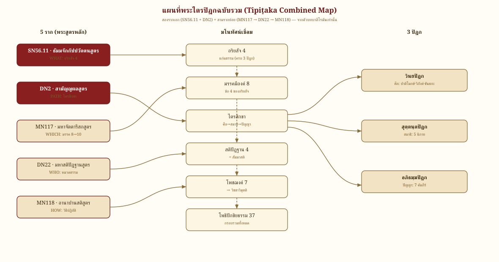

# แผนที่พระไตรปิฎก (Tipiṭaka Map)

> **งานวิจัย:** พระสูตรหลักสามารถใช้เป็น "โครงสร้าง/สารบัญ" เชื่อมโยงครอบคลุมพระไตรปิฎกทั้ง 3 ปิฎกได้หรือไม่ — วิเคราะห์จาก**ตัวบทบาลีโรมันเท่านั้น** (tripitaka-mcp ทั้ง local + online, ฐานข้อมูล SuttaCentral `bilara-data` CC0)

---

## 🎯 ข้อค้นพบหลัก (ผลรวมงานวิจัย 5 ชุด)

**แผนที่พระไตรปิฎกที่สมบูรณ์ที่สุด = "สองรากเอก + สามรากย่อย":**

| บทบาท | พระสูตร | ครอบคลุม |
|---|---|---|
| **โครง/สารบัญ (WHAT)** | ธัมมจักกัปปวัตตนสูตร [SN 56.11](https://tripitaka-mcp.com/read/sn56.11) | อริยสัจ 4 = ธรรมะทั้งหมด (ครบ 3 ปิฎก 3 รูปแบบ) |
| **ลำดับมรรค (PATH)** | สามัญญผลสูตร [DN 2](https://tripitaka-mcp.com/read/dn2) | ไตรสิกขา = 3 ปิฎกเป็น 3 ขั้น |
| วิเคราะห์มรรค (WHICH) | มหาจัตตารีสกสูตร [MN 117](https://tripitaka-mcp.com/read/mn117) | มรรค 8→10, โลกิย/โลกุตตร → อภิธรรม |
| หมวดธรรม (WHO) | มหาสติปัฏฐานสูตร [DN 22](https://tripitaka-mcp.com/read/dn22) | นิวรณ์/ขันธ์/อายตนะ/โพชฌงค์ → อภิธรรม |
| วิธีปฏิบัติ (HOW) | อานาปานสติสูตร [MN 118](https://tripitaka-mcp.com/read/mn118) | อานาปานสติ 16 ขั้น → วิชชาวิมุตติ |

**แกนคู่ของแผนที่:** **SN 56.11** บอกว่า "ธรรมะคืออะไร" (อริยสัจ 4) + **DN 2** บอกว่า "ปฏิบัติอย่างไรเป็นลำดับ" (ไตรสิกขา = 3 ปิฎก) — ทั้งสองบรรจบกันที่ "มรรค" (อริยสัจข้อ 4 = ไตรสิกขา)

---

## 🗺️ แผนที่ฉบับรวม (Combined Map)

- 📄 **หน้ารวมงานวิจัย:** [`index.html`](index.html) (เปิดใน GitHub Pages หรือคลิกใน repo)
- 📄 **รายงานฉบับรวม:** [`combined-map/report.md`](combined-map/report.md)
- 🔗 **โครงสร้าง node–edge รวม:** [`combined-map/combined_graph.json`](combined-map/combined_graph.json) (21 โหนด, 24 ขอบ พร้อมหลักฐาน)
- 🖼️ **แผนภาพรวม:** [`combined-map/combined_map.svg`](combined-map/combined_map.svg) / [`png`](combined-map/combined_map.png)

---

## 📂 งานวิจัย 5 ชุด

| # | พระสูตร | รายงาน | แผนที่ | ข้อมูล | เทียบเคียง |
|---|---|---|---|---|---|
| 1 | **ธัมมจักกัปปวัตตนสูตร** (SN 56.11) | [report.md](dhammacakka-mapping/report.md) | [map.png](dhammacakka-mapping/map.png) / [svg](dhammacakka-mapping/map.svg) | [survey_data.csv](dhammacakka-mapping/survey_data.csv) | [coverage_by_nikaya.csv](dhammacakka-mapping/coverage_by_nikaya.csv) |
| 2 | **มหาสติปัฏฐานสูตร** (DN 22) | [report.md](mahasatipatthana-mapping/report.md) | [map.png](mahasatipatthana-mapping/map.png) | [survey_data.csv](mahasatipatthana-mapping/survey_data.csv) | [comparison.csv](mahasatipatthana-mapping/comparison.csv) |
| 3 | **อานาปานสติสูตร** (MN 118) | [report.md](anapanasati-mapping/report.md) | [map.png](anapanasati-mapping/map.png) | [survey_data.csv](anapanasati-mapping/survey_data.csv) | [comparison_3suttas.csv](anapanasati-mapping/comparison_3suttas.csv) |
| 4 | **มหาจัตตารีสกสูตร** (MN 117) | [report.md](mahacattarisaka-mapping/report.md) | [map.png](mahacattarisaka-mapping/map.png) | [survey_data.csv](mahacattarisaka-mapping/survey_data.csv) | [comparison_4suttas.csv](mahacattarisaka-mapping/comparison_4suttas.csv) |
| 5 | **สามัญญผลสูตร** (DN 2) | [report.md](samannaphala-mapping/report.md) | [map.png](samannaphala-mapping/map.png) | [survey_data.csv](samannaphala-mapping/survey_data.csv) | [comparison_5suttas.csv](samannaphala-mapping/comparison_5suttas.csv) |

---

## 🔬 วิธีวิจัย (methodology)

1. **แหล่งข้อมูล:** ตัวบท**ภาษาบาลีโรมัน**เท่านั้น (ไม่ใช้การแปลภาษาอังกฤษ/ภาษาอื่นในการวิเคราะห์) ผ่าน tripitaka-mcp ทั้ง local และ online — ฐานข้อมูล SuttaCentral `bilara-data` (CC0)
2. **เครื่องมือ:** `get_sutta` (ดึงตัวบท/โครงสร้าง) + `survey_corpus` (นับการกระจายศัพท์แบบ exhaustive `complete:true`)
3. **ขั้นตอน:** สกัดศัพท์หลักจากตัวบท → สำรวจการกระจายทั่ว 3 ปิฎก → เจาะปมเชื่อมด้วยพระสูตรสะพาน (SN 45.8, MN 44, AN 3.89, DN 16) → ทดสอบสมมติฐาน → สร้างแผนที่ node–edge
4. **การยืนยัน:** cross-check ผลระหว่าง server local กับ online (ผลตรงกัน)

---

## ⚠️ ข้อควรทราบ

- ตัวเลขศัพท์กว้างบางตัว (ศีล/ปัญญา/ขันธ์/ฌาน/อินทรีย์) เป็น**ขอบเขตบน** (stem ติดคำพ้องรูป เช่น `sīla` ติด `silā`=หิน) — ใช้ยืนยัน "ทิศทางการเข้าถึงปิฎก" ไม่ใช่จำนวนธรรมะจริง
- การเชื่อม "วินัย" เป็นเชิงมโนทัศน์ (ผ่านไตรสิกขา/ศีล/สิกขาบท) ตามที่ตัวบาลีบัญญัติใน [MN 44](https://tripitaka-mcp.com/read/mn44)

---

*งานวิจัยนี้ใช้ข้อมูลเพื่อการศึกษา (Dhamma Dāna) เท่านั้น; โปรดสอบทานกับฉบับพิมพ์ล่าสุดก่อนอ้างอิงทางวิชาการ. ข้อมูลต้นฉบับ: SuttaCentral `bilara-data` (CC0)*
