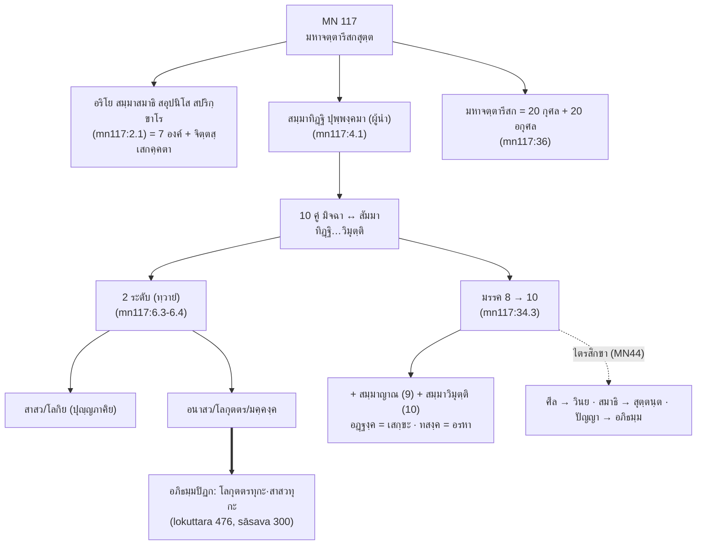

# มหาจัตตารีสกสูตร (MN 117) เป็นโครงสร้างและสารบัญของพระไตรปิฎกได้หรือไม่
### รายงานวิจัย + เทียบเคียง 4 สูตร (SN 56.11 / DN 22 / MN 118 / MN 117) — วิเคราะห์จากตัวบทบาลีโรมันเท่านั้น

> **ข้อกำหนดวิธีวิจัย:** หลักฐานทุกชิ้นจากตัวบท**ภาษาบาลีโรมัน**โดยตรง (tripitaka-mcp local + online, ฐานข้อมูล SuttaCentral `bilara-data`) ไม่ได้พึ่งการแปลภาษาอังกฤษ/ภาษาอื่นในการวิเคราะห์ ตัวเลขทุกตัวสืบย้อนได้จาก `survey_corpus` (exhaustive `complete:true`)

---

## บทคัดย่อ (Abstract)

**คำตอบ: ได้ และเป็น "รากที่เชื่อมอภิธรรมด้วยวิธีวิเคราะห์ (2 ระดับ) แน่นที่สุด" ในสี่สูตร**

มหาจัตตารีสกสูตร ([MN 117](https://tripitaka-mcp.com/read/mn117)) ใช้เป็นราก/สารบัญได้ โดยแกนคือ **"อริโย สมฺมาสมาธิ สอุปนิโส สปริกฺขาโร"** (สัมมาสมาธิอันประเสริฐพร้อมทั้งอุปนิสัยและบริขาร = องค์ 7 + เอกัคคตา) และมีจุดเด่นสองประการที่ตัวบาลีระบุชัด:

1. **การแยกมรรคเป็น 2 ระดับ (ทฺวายํ):** *"สมฺมาทิฏฺฐิ สาสวา ปุญฺญภาคิยา อุปธิเวปกฺกา"* (โลกิยะ) ↔ *"สมฺมาทิฏฺฐิ อริยา อนาสวา โลกุตฺตรา มคฺคงฺคา"* (โลกุตตระ) — [mn117:6.3–6.4](https://tripitaka-mcp.com/read/mn117#mn117:6.3)
2. **การขยายมรรค 8 → 10:** *"อฏฺฐงฺคสมนฺนาคโต เสกฺโข, ทสงฺคสมนฺนาคโต อรหา"* (องค์ 8 = เสขะ, องค์ 10 = อรหันต์; เพิ่มสัมมาญาณ + สัมมาวิมุตติ) — [mn117:34.4](https://tripitaka-mcp.com/read/mn117#mn117:34.4)

**ข้อค้นพบชี้ขาดในการเทียบ 4 สูตร:** ศัพท์ชุด "2 ระดับ" (โลกุตตร/โลกิย/สาสว/อนาสว) **คือหมวดจำแนกของอภิธรรมโดยตรง** — ปรากฏในอภิธรรมถึง **โลกุตตร 476, สาสว 300, โลกิย 270** ข้อความ (ธัมมสังคณีมี "โลกิยทุกะ/สาสวทุกะ/อนาสวทุกะ" เป็นหมวดของตัวเอง) → **MN 117 คือสะพานไปอภิธรรมที่ "แน่น" ที่สุดทางวิธีวิเคราะห์** (ต่างจาก DN 22 ที่เชื่อมทาง *เนื้อหา* — นิวรณ์/ขันธ์/อายตนะ)

**จึงสรุปอันดับ "ความครอบคลุม 3 ปิฎก" (เชิงศัพท์):** **SN 56.11 ยังคงดีที่สุด (ครบ 3 ปิฎก 3 รูปแบบ)** ส่วน MN 117 ดีที่สุดเฉพาะทาง "อภิธรรม"

---

## 1. บทนำและสมมติฐาน

**คำถาม:** มหาจัตตารีสกสูตรใช้เป็นราก/สารบัญเชื่อมพระไตรปิฎกได้หรือไม่ และใน 4 สูตร ใครครอบคลุมดีที่สุด?

**สมมติฐาน H1 (ทดสอบแล้ว สนับสนุน):** ศัพท์แกนของ MN 117 (สัมมาทิฏฐิ/สัมมาสมาธิ/โลกุตตร/สาสว/อนาสว/มัคคังคะ) กระจายถึงปิฎกทั้งสาม โดยหนักไปทาง**อภิธรรม**อย่างยิ่ง (ผ่านหมวดจำแนก 2 ระดับ) และอ่อนในวินัย

**สมมติฐาน H2 (ทดสอบแล้ว สนับสนุน):** MN 117 เป็น "ปมแตกแขนงของสัจจะข้อ 4 (มรรค)" — คือการขยาย "อริยอัฏฐังคิกมรรค" (ซึ่ง SN 56.11 ระบุสั้น ๆ) ให้ครบ 8–10 องค์พร้อมวิธีวิเคราะห์ 2 ระดับ

---

## 2. วิธีการ (Methods)

`get_sutta(mn117, pali)` ตัวบทเต็ม 152 ข้อความ → สกัดศัพท์หลัก → `survey_corpus` (pali, stem, exhaustive) นับต่อปิฎก → เจาะปมเชื่อม (SN 45.8, MN 44, DN 16) → cross-check local/online

---

## 3. ผล (Results)

### 3.1 โครงสร้างภายในของ MN 117 (จากบาลีล้วน)

```
MN 117 มหาจตฺตารีสกสุตฺต
├─ แก่น: "อริโย สมฺมาสมาธิ สอุปนิโส สปริกฺขาโร"  [mn117:2.1]
│     = องค์ 7 (ทิฏฺฐิ…สติ) + จิตฺตสฺเสกคฺคตา  [mn117:3.2–3.3]
├─ สมฺมาทิฏฺฐิ ปุพฺพงฺคมา (สัมมาทิฏฐิเป็นผู้นำของทุกองค์)  [mn117:4.1]
├─ 10 คู่ มิจฉา ↔ สัมมา:  [mn117:5–33]
│     ทิฏฺฐิ·สงฺกปฺป·วาจา·กมฺมนฺต·อาชีว·วายาม·สติ·สมาธิ·ญาณ·วิมุตฺติ
├─ แต่ละองค์แยก 2 ระดับ (ทฺวายํ):  [mn117:6.3–6.4]
│     • สาสว / ปุญฺญภาคิย / อุปธิเวปกฺก (= โลกิยะ)
│     • อนาสว / อริย / โลกุตฺตร / มคฺคงฺค (= โลกุตตระ)
├─ มรรค 8 → 10:  [mn117:34.3]
│     สมฺมาทิฏฺฐิ → … → สมฺมาสมาธิ → สมฺมาญาณ → สมฺมาวิมุตฺติ
│     "อฏฺฐงฺคสมนฺนาคโต เสกฺโข · ทสงฺคสมนฺนาคโต อรหา"  [mn117:34.4]
└─ สรุป: "วีสติ กุสลปกฺขา, วีสติ อกุสลปกฺขา" (มหาจัตตารีสกะ = 20+20)  [mn117:36]
```

### 3.2 การกระจายศัพท์หลักทั่วพระไตรปิฎก

| ศัพท์ (บาลี) | สุตตันตะ | วินัย | อภิธรรม | รวม | ครอบคลุม 3 ปิฎก |
|---|---:|---:|---:|---:|---|
| sammāsamādhi (สัมมาสมาธิ) | 463 | 2 | 126 | 591 | ✅ |
| sammādiṭṭhi (สัมมาทิฏฐิ) | 826 | 5 | 235 | 1066 | ✅ |
| micchādiṭṭhi (มิจฉาทิฏฐิ) | 543 | 20 | 55 | 618 | ✅ |
| **lokuttara (โลกุตตร)** | 160 | **0** | **476** | 636 | ◐ (อภิธรรมเด่น) |
| **lokiya (โลกิย)** | 22 | **0** | **270** | 292 | ◐ (อภิธรรมเด่น) |
| **sāsava (สาสว)** | 75 | **0** | **300** | 375 | ◐ (อภิธรรมเด่น) |
| anāsava (อนาสว) | 365 | 8 | 163 | 536 | ✅ |
| **sammāñāṇa (สัมมาญาณ, องค์ 9)** | 32 | **0** | **0** | 32 | ◐ (เฉพาะสุตตันตะ) |
| **sammāvimutti (สัมมาวิมุตติ, องค์ 10)** | 103 | **0** | **0** | 103 | ◐ (เฉพาะสุตตันตะ) |
| sekkha (เสขะ) | 100 | 34 | 227 | 361 | ✅ |
| maggaṅga (มัคคังคะ) | 51 | 0 | 160 | 211 | ◐ (อภิธรรมเด่น) |
| aṭṭhaṅgika (มรรค 8) | 244 | 17 | 0 | 261 | ◐ |
| ariyasacca (อริยสัจ 4) | 344 | 23 | 34 | 401 | ✅ |
| nibbāna (นิพพาน) | 1408 | 14 | 377 | 1799 | ✅ |

**ข้อมูลเต็ม:** [`survey_data.csv`](<survey_data.csv>)

### 3.3 ข้อค้นพบชี้ขาด

**1) MN 117 เป็น "ปมแตกแขนงของสัจจะข้อ 4"** — SN 56.11 ระบุ "อริโย อฏฺฐงฺคิโก มคฺโค" ไว้สั้น ๆ ([sn56.11:3.3](https://tripitaka-mcp.com/read/sn56.11#sn56.11:3.3)) ส่วน MN 117 **ขยายมรรคนั้นเต็มรูป**: แยกมิจฉา/สัมมา 10 คู่ + แยก 2 ระดับ (โลกิยะ/โลกุตตระ) + ขยายเป็น 10 องค์ (เพิ่มสัมมาญาณ/สัมมาวิมุตติ) — จึงเป็น "คัมภีร์วิเคราะห์มรรค" ของสุตตันตปิฎก

**2) ศัพท์ "2 ระดับ" คือสะพานไปอภิธรรมที่แน่นที่สุด** — ธัมมสังคณี (คัมภีร์แรกของอภิธรรม) มีหมวด **"โลกียทุกะ"** ([ds1.2:23.0](https://tripitaka-mcp.com/read/ds1.2#ds1.2:23.0)), **"สาสวทุกะ"** ([ds1.2:29.0](https://tripitaka-mcp.com/read/ds1.2#ds1.2:29.0)), **"อนาสวทุกะ"** ([ds1.2:30.1](https://tripitaka-mcp.com/read/ds1.2#ds1.2:30.1)) เป็นหมวดจำแนกของตน → ศัพท์โลกุตตรปรากฏในอภิธรรม 476 ข้อความ (เทียบสุตตันตะ 160) และโลกิย 270 (เทียบสุตตันตะ 22) — **อัตราส่วนกลับด้านชัดเจน** แปลว่า MN 117 ใช้ "วิธีจำแนก" เดียวกับอภิธรรม

**3) องค์ที่ 9–10 (สัมมาญาณ/สัมมาวิมุตติ) อยู่เฉพาะสุตตันตะ** — เช่นเดียวกับ "วิชชาวิมุตติ" ของ MN 118 (54/0/0) → คำศัพท์ "ปลายทาง" ของการตรัสรู้เป็นคำของสุตตันตะ ไม่ใช่วัตถุที่อภิธรรม/วินัยจำแนก

### 3.4 เทียบเคียง 4 สูตร (ตาราง)

| มิติ | SN 56.11 | DN 22 | MN 118 | MN 117 |
|---|---|---|---|---|
| **แก่น** | อริยสัจ 4 + มรรค 8 | สติปัฏฐาน 4 + บรรจุอริยสัจ | อานาปานสติ 16 ขั้น | อริโย สมฺมาสมาธิ + มรรค 8→10 |
| **เอกลักษณ์** | tiparivaṭṭa — 7 | paṭikūlamanasikāra — 2 | vijjāvimutti — 54 | โลกุตตร/โลกิย ทวาร |
| **→ วินัย** | **23** (ปฐมเทศนา) | ~4 | ~4 | micchādiṭṭhi 20, anāsava 8 |
| **→ อภิธรรม** | 34 | นิวรณ์ 387, ธาตุ 1735 | satipaṭṭhāna 96 | **โลกุตตร 476, สาสว 300, โลกิย 270** |
| **→ สุตตันตะ** | 344 | 369, vedanā 2805 | 176 | 543 (มิจฉาทิฏฐิ), 826 (สัมมาทิฏฐิ) |
| **ครอบคลุม 3 ปิฎก (สรุป)** | **ครบสุด** | ครบ แต่ในวินัยอ่อน | อ่อนสุด | อภิธรรมหนักสุด (ทางวิธี); วินัยอ่อน |
| **บทบาทในแผนที่รวม** | โครง/สารบัญ (WHAT) | หมวดธรรม (WHO) | วิธีปฏิบัติ (HOW) | **วิเคราะห์มรรค (WHICH: 2 ระดับ, 8→10)** |

**ตารางเต็ม:** [`comparison_4suttas.csv`](<comparison_4suttas.csv>)

---

## 4. แผนที่และโครงสร้าง (The Map)


- **SVG (ความละเอียดสูง):** [`map.svg`](<map.svg>)
- **โครงสร้าง node–edge (13 ขอบ, 23 โหนด):** [`map_edges.csv`](<map_edges.csv>) / [`map_graph.json`](<map_graph.json>)



---

## 5. อภิปราย (Discussion)

### 5.1 สี่ราก = สี่ชั้นของการ "ซูม" เข้าไปในมรรค (แผนที่สมบูรณ์)

ผลเทียบเคียง 4 สูตรชี้ว่า **ทั้งสี่ไม่ใช่คู่แข่ง แต่เป็น 4 ชั้นที่ซ้อนกัน (nested hierarchy)** โดยตัวบาลีเชื่อมเอง:

```
SN 56.11  (ระดับ 1)  อริยสัจ 4 = ธรรมะทั้งหมดใน 4 บรรทัด
   └─ ข้อ 4 "มรรค" → MN 117  (ระดับ 2)  ขยายมรรค 8→10 องค์ + แยก 2 ระดับ (โลกิย/โลกุตตร)
         └─ องค์ที่ 7 "สัมมาสติ" → DN 22  (ระดับ 3)  ขยายเป็น สติปัฏฐาน 4 (นิวรณ์/ขันธ์/อายตนะ/โพชฌงค์/สัจจะ)
               └─ วิธีเจริญสติปัฏฐาน → MN 118  (ระดับ 4)  อานาปานสติ 16 ขั้น → โพชฌงค์ → วิชชาวิมุตติ
```

**หลักฐานของความซ้อนนี้ (ในตัวบาลี):**
- สัมมาทิฏฐิ = ญาณในอริยสัจ 4 ([mn117:8.2](https://tripitaka-mcp.com/read/mn117#mn117:8.2) = [sn45.8:3.2](https://tripitaka-mcp.com/read/sn45.8#sn45.8:3.2)) → MN 117 ชี้กลับ SN 56.11
- สัมมาสติ = สติปัฏฐาน 4 ([sn45.8:9.2](https://tripitaka-mcp.com/read/sn45.8#sn45.8:9.2)) → DN 22 ต่อจาก MN 117
- สติปัฏฐาน = สมาธินิมิตต์ ([mn44:12.3](https://tripitaka-mcp.com/read/mn44#mn44:12.3)) → MN 118 ต่อจาก DN 22
- ทั้ง 4 สูตรอยู่ใน "โพธิปักขิยธรรม 37" ([dn16:3.50.5](https://tripitaka-mcp.com/read/dn16#dn16:3.50.5))

### 5.2 MN 117 กับ DN 22: สะพานไปอภิธรรมคนละแบบ

| | DN 22 (ทาง**เนื้อหา**) | MN 117 (ทาง**วิธี**) |
|---|---|---|
| เชื่อมด้วย | นิวรณ์/ขันธ์/อายตนะ/ธาตุ/เวทนา (สิ่งที่อภิธรรมวิเคราะห์) | โลกิย/โลกุตตร, สาสว/อนาสว (วิธีจำแนกของอภิธรรม) |
| ตัวเลขอภิธรรม | ขันธ์ 4963, ธาตุ 1735 | โลกุตตร 476, สาสว 300, โลกิย 270 |
| หลักฐาน | วิภังค์/ธาตุกถา/ยมก | ธัมมสังคณี (โลกียทุกะ/สาสวทุกะ/อนาสวทุกะ) |

→ DN 22 ให้ **"วัตถุ"** ที่อภิธรรมวิเคราะห์; MN 117 ให้ **"วิธีจำแนก"** ที่อภิธรรมใช้ — สองสูตรเสริมกันเป็นสะพานคู่ไปอภิธรรม

### 5.3 คำตอบสุดท้าย (ใครเป็นรากที่ดีที่สุด)

| เป้าหมาย | เลือก |
|---|---|
| สารบัญครอบคลุม **3 ปิฎกครบ** (โดยเฉพาะวินัย) | **SN 56.11** 🥇 |
| ลงลึก**อภิธรรมทางวิธีจำแนก (2 ระดับ)** | **MN 117** 🥈 |
| ลงลึก**อภิธรรมทางหมวดธรรม (เนื้อหา)** | **DN 22** 🥉 |
| **วิธีปฏิบัติ**สมบูรณ์เป็นลำดับ | **MN 118** |

**อันดับ "ความครอบคลุม 3 ปิฎกเชิงศัพท์" (ล้วน ๆ): SN 56.11 > DN 22 ≈ MN 117 > MN 118** — โดย SN 56.11 ชนะเพราะอริยสัจ 4 ปรากฏใน 3 ปิฎก 3 รูปแบบวรรณกรรม (แสดง/เล่า/วิเคราะห์) ซึ่งเป็นคุณสมบัติเฉพาะตัว

**แต่แผนที่ที่สมบูรณ์ที่สุด = ใช้ 4 ชั้นซ้อนกัน** (SN 56.11 → MN 117 → DN 22 → MN 118) ซึ่งเป็น "สารบัญ + การวิเคราะห์ + หมวดธรรม + วิธีปฏิบัติ" ครบวงจร

---

## 6. ข้อจำกัดและการตรวจสอบตนเอง

1. **ศัพท์กว้างนับเกิน (over-match):** `sekkha` ในวินัย (34) ส่วนมากเป็นคำ "เสกขสมฺมต" (ตระกูลที่สมมติว่ายังศึกษาอยู่) ในปาติโมกข์ ไม่ใช่ "เสขะ" ในความหมาย "ผู้มีองค์ 8" ของ MN 117 → ไม่ควรนำมาอ้างว่าเชื่อมธรรมะตรง ๆ
2. **โลกุตตร/โลกิย/สาสว = 0 ในวินัย** เป็นข้อเท็จจริงเชิงศัพท์ — วินัยไม่ใช้หมวดจำแนกแบบอภิธรรม; แต่ "ศีล" (ที่ MN 117 กล่าวถึงในสัมมาวาจา/กัมมันตะ/อาชีวะ) เชื่อมวินัยผ่านไตรสิกขา (mn44:11.3)
3. **ไม่ได้นับระดับนิกาย** แบบ exhaustive (ทำเฉพาะอริยสัจในงาน SN 56.11)
4. ยังไม่ได้เทียบรากอื่น เช่น สามัญญผลสูตร (DN 2), มหาสติปัฏฐานเทียบกับมัชฌิมนิกาย (MN 10) — งานต่อยอด

---

## 7. สรุป

**มหาจัตตารีสกสูตรใช้เป็นราก/สารบัญได้** โดยเป็นรากชนิด **"การวิเคราะห์มรรค (8→10 องค์ + 2 ระดับ)"** ที่ (1) ขยายอริยอัฏฐังคิกมรรคให้เต็มรูป (มิจฉา/สัมมา 10 คู่), (2) แยกมรรคเป็นโลกิยะ/โลกุตตระ — ซึ่งคือ**หมวดจำแนกของอภิธรรมโดยตรง** (สะพานไปอภิธรรมที่แน่นที่สุดทางวิธี), และ (3) ขยายมรรค 8 เป็น 10 องค์ (เสขะ→อรหันต์)

**แผนที่พระไตรปิฎกที่สมบูรณ์ที่สุด = 4 ชั้นซ้อนกัน:**
1. **SN 56.11** — โครง/สารบัญ (WHAT: อริยสัจ 4 ครอบคลุม 3 ปิฎก)
2. **MN 117** — วิเคราะห์มรรค (WHICH: 8→10 องค์, โลกิย/โลกุตตร → อภิธรรม)
3. **DN 22** — หมวดธรรม (WHO: นิวรณ์/ขันธ์/อายตนะ/โพชฌงค์ → อภิธรรมเนื้อหา)
4. **MN 118** — วิธีปฏิบัติ (HOW: อานาปานสติ 16 ขั้น → วิชชาวิมุตติ)

**ไฟล์ที่ส่งมอบ (โฟลเดอร์ `mahacattarisaka-mapping/`):**
- [`report.md`](<report.md>) — รายงานฉบับนี้
- [`map.svg`](<map.svg>) / [`map.png`](<map.png>) — แผนภาพโครงสร้าง
- [`survey_data.csv`](<survey_data.csv>) — ผลสำรวจ 14 ศัพท์แยกต่อปิฎก
- [`comparison_4suttas.csv`](<comparison_4suttas.csv>) — ตารางเทียบ 4 สูตร
- [`map_edges.csv`](<map_edges.csv>) / [`map_graph.json`](<map_graph.json>) — โครงสร้าง node–edge

---

*งานวิจัยนี้ใช้หลักฐานจากตัวบทบาลี SuttaCentral `bilara-data` (CC0) ผ่าน tripitaka-mcp ทั้ง local และ online. ข้อมูลเพื่อการศึกษา (Dhamma Dāna) เท่านั้น; โปรดสอบทานกับฉบับพิมพ์ล่าสุดก่อนอ้างอิงทางวิชาการ.*
