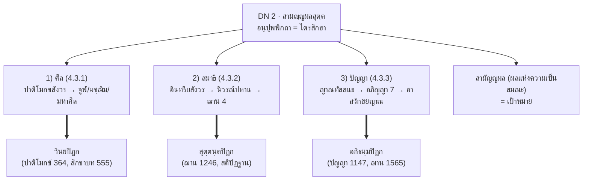

# สามัญญผลสูตร (DN 2) เป็นโครงสร้างและสารบัญของพระไตรปิฎกได้หรือไม่
### รายงานวิจัย + เทียบเคียง 5 สูตร (SN 56.11 / DN 22 / MN 118 / MN 117 / DN 2) — วิเคราะห์จากตัวบทบาลีโรมันเท่านั้น

> **ข้อกำหนดวิธีวิจัย:** หลักฐานทุกชิ้นจากตัวบท**ภาษาบาลีโรมัน**โดยตรง (tripitaka-mcp local + online, ฐานข้อมูล SuttaCentral `bilara-data`) ไม่ได้พึ่งการแปลภาษาอังกฤษ/ภาษาอื่นในการวิเคราะห์ ตัวเลขทุกตัวสืบย้อนได้จาก `survey_corpus` (exhaustive `complete:true`)

---

## บทคัดย่อ (Abstract)

**คำตอบ: ได้ และเป็น "รากที่เห็น 3 ปิฎกเป็น 3 ขั้นของมรรคเดียว" ชัดเจนที่สุดในห้าสูตร**

สามัญญผลสูตร ([DN 2](https://tripitaka-mcp.com/read/dn2)) ใช้เป็นราก/สารบัญได้ โดยแกนคือ **"อนุปุพพิกถา" (ทางสายค่อยเป็นค่อยไป)** ที่บรรจุ **ไตรสิกขา (ศีล → สมาธิ → ปัญญา) ครบเป็นลำดับเดียว** ตั้งแต่บรรพชาถึงอรหัต:

```
ศีล (4.3.1): ปาติโมกขสังวร → จูฬ/มชฺฌิม/มหาศีล   → วินยปิฏก
สมาธิ (4.3.2): อินทรียสังวร → นิวรณ์ปหาน → ฌาน 4   → สุตฺตนฺตปิฏก
ปัญญา (4.3.3): ญาณทัสสนะ → อภิญญา 7 → อาสวักขยญาณ → อภิธมฺมปิฏก
```

**ข้อค้นพบชี้ขาดในการเทียบ 5 สูตร:** DN 2 เชื่อม 3 ปิฎกด้วย **"ศัพท์ของแต่ละปิฎกเอง"** — ขั้นแรกคือ **"ปาติโมกขสังวร"** ([dn2:42.1](https://tripitaka-mcp.com/read/dn2#dn2:42.1)) ซึ่งเป็นศัพท์ของวินัยโดยตรง (ปาติโมกข์ 364, สิกขาบท 555, ศีล 310 ข้อความในวินัย) ต่างจาก SN 56.11 ที่เชื่อมวินัยผ่าน "เรื่องเล่าปฐมเทศนา" จึงเป็นรากที่เห็น **"วินัย = ศีล, สุตตันตะ = สมาธิ, อภิธรรม = ปัญญา"** อย่างเป็นลำดับเดียวได้ชัดที่สุด

---

## 1. บทนำและสมมติฐาน

**คำถาม:** สามัญญผลสูตรใช้เป็นราก/สารบัญเชื่อมพระไตรปิฎกได้หรือไม่ และใน 5 สูตร ใครครอบคลุมดีที่สุด?

**สมมติฐาน H1 (ทดสอบแล้ว สนับสนุน):** ศัพท์แกนของ DN 2 (ศีล/ปาติโมกขสังวร/สมาธิ/ฌาน/ปัญญา/ญาณ/อภิญญา/สามัญญผล) กระจายถึงปิฎกทั้งสาม โดยขั้น "ศีล" เชื่อมวินัยด้วยศัพท์ของวินัยเอง ขั้น "สมาธิ" เชื่อมสุตตันตะ ขั้น "ปัญญา" เชื่อมอภิธรรม

**สมมติฐาน H2 (ทดสอบแล้ว สนับสนุน):** DN 2 เป็นรูปธรรมเชิงลำดับของ **"ไตรสิกขา = 3 ปิฎก"** (สะพานที่ตัวบาลีบัญญัติใน MN 44 / AN 3.89) — จึงเป็น "แผนที่ 3 ปิฎก" ที่ตรงไปตรงมาที่สุด

---

## 2. วิธีการ (Methods)

`get_sutta(dn2, pali)` (outline + ตัวบท) → สกัดศัพท์หลัก → `survey_corpus` (pali, stem, exhaustive) นับต่อปิฎก → เจาะปมเชื่อม (MN 44, AN 3.89, SN 45.8) → cross-check local/online

---

## 3. ผล (Results)

### 3.1 โครงสร้างภายในของ DN 2 (จากบาลีล้วน)

```
DN 2 สามญฺญผลสุตฺต  (650 ข้อความ, 28 หมวด)
├─ ปุจฉา: "สามญฺญผล" (ผลแห่งความเป็นสมณะคืออะไร)  [dn2:11]
├─ (ทรงตอบ) อนุปุพพิกถา = ไตรสิกขา 3 ขั้น:
│   ├─ 4.3.1 ศีล: ปาติโมกขสังวร → จูฬศีล → มชฺฌิมศีล → มหาศีล  [dn2:42–64]
│   ├─ 4.3.2 สมาธิ: อินทรียสังวร → สติสัมปชัญญะ → สันโดษ
│   │               → นิวรณ์ปหาน → ฌาน 1–4  [dn2:64–84]
│   └─ 4.3.3 ปัญญา: ญาณทัสสนะ → มโนมยิทธิ → อิทธิวิธ → ทิพพโสต
│                    → เจโตปริย → ปุพเพนิวาสานุสติ → ทิพพจักขุ → อาสวักขยญาณ  [dn2:83–98]
└─ สามัญญผล (ผลปรากฏ) + อชาตศัตรูประกาศตนเป็นอุบาสก  [dn2:99–102]
```

### 3.2 การกระจายศัพท์หลักทั่วพระไตรปิฎก

| ศัพท์ (บาลี) | สุตตันตะ | วินัย | อภิธรรม | รวม | ครอบคลุม 3 ปิฎก |
|---|---:|---:|---:|---:|---|
| **pātimokkhasaṁvara (ปาติโมกขสังวร)** | 71 | 4 | 3 | 78 | ✅ (ขั้นแรก = สะพานวินัย) |
| **sīla (ศีล)** ⚠ | 2296 | **310** | 633 | 3239 | ✅ |
| **samādhi (สมาธิ)** | 1847 | 83 | 374 | 2304 | ✅ |
| **paññā (ปัญญา)** ⚠ | 5351 | **1963** | **1147** | 8461 | ✅ |
| nīvaraṇa (นิวรณ์ 5) | 232 | 0 | 387 | 619 | ◐ |
| jhāna (ฌาน) ⚠ | 1246 | 248 | **1565** | 3059 | ✅ |
| sāmaññaphala (สามัญญผล) | 89 | 2 | 45 | 136 | ✅ |
| indriyasaṁvara (อินทรียสังวร) | 30 | 0 | 0 | 30 | ◐ (เฉพาะสุตตันตะ) |
| satisampajañña (สติสัมปชัญญะ) | 48 | 0 | 2 | 50 | ◐ |
| ñāṇadassana (ญาณทัสสนะ) | 99 | 19 | 0 | 118 | ◐ |
| āsavakkhaya (อาสวักขยญาณ) | 46 | 1 | 3 | 50 | ◐ |
| abhiññā (อภิญญา) ⚠ | 1182 | 40 | 111 | 1333 | ✅ |
| dibbacakkhu (ทิพพจักขุ) | 99 | 1 | 67 | 167 | ✅ |
| anupubba (อนุปุพพ/ลำดับ) | 106 | 7 | 25 | 138 | ✅ |
| nibbāna (นิพพาน) | 1408 | 14 | 377 | 1799 | ✅ |

**ข้อมูลเต็ม:** [`survey_data.csv`](<survey_data.csv>)

### 3.3 ข้อค้นพบชี้ขาด

**1) DN 2 = "ไตรสิกขา" ที่เป็นรูปธรรมเชิงลำดับ** — ตัวบาลีระบุไตรสิกขา = *"อธิสีลสิกขา, อธิจิตฺตสิกขา, อธิปญฺญาสิกขา"* ([an3.89:1.3](https://tripitaka-mcp.com/read/an3.89#an3.89:1.3)) และ DN 2 คือการขยายไตรสิกขานั้นเป็นลำดับเต็ม (ศีล 3 ชั้น → ฌาน 4 → ญาณ 7) — จึงเป็น **"แผนที่ 3 ปิฎก" ที่ตรงไปตรงมาที่สุด**: ศีล = วินัย, สมาธิ = สุตตันตะ, ปัญญา = อภิธรรม (สะพาน [mn44:11.3–11.5](https://tripitaka-mcp.com/read/mn44#mn44:11.3))

**2) ขั้นแรกของ DN 2 คือ "ปาติโมกขสังวร" = ศัพท์ของวินัยโดยตรง** — *"ปาติโมกฺขสํวรสํวุโต วิหรติ … สมาทาย สิกฺขติ สิกฺขาปเทสุ"* ([dn2:42.1](https://tripitaka-mcp.com/read/dn2#dn2:42.1)) → DN 2 เชื่อมวินัยด้วย **"คำศัพท์ที่วินัยใช้เอง"** (ปาติโมกข์/สิกขาบท) ไม่ใช่แค่เรื่องเล่า — ต่างจาก SN 56.11 ที่เชื่อมวินัยผ่านปฐมเทศนาเรื่องเดียวกัน

**3) ศัพท์ "สามัญญผล" ปรากฏครบ 3 ปิฎก (89/2/45)** — "ผล" ของการปฏิบัติเป็นหมวดที่ทั้งสุตตันตะ (บรรยาย), วินัย (ปาติโมกข์กล่าวถึง), อภิธรรม (จำแนกผล) กล่าวถึง → DN 2 มีทั้ง "ทาง" (ไตรสิกขา) และ "ผล" (สามัญญผล) ครบ

### 3.4 เทียบเคียง 5 สูตร (ตาราง)

| มิติ | SN 56.11 | DN 22 | MN 118 | MN 117 | DN 2 |
|---|---|---|---|---|---|
| **แก่น** | อริยสัจ 4 | สติปัฏฐาน 4 | อานาปานสติ 16 ขั้น | สมฺมาสมาธิ + มรรค 8→10 | **ไตรสิกขา (ศีล→สมาธิ→ปัญญา)** |
| **เอกลักษณ์** | tiparivaṭṭa — 7 | paṭikūla — 2 | vijjāvimutti — 54 | โลกุตตร/โลกิย | sāmaññaphala + ปาติโมกขสังวร |
| **→ วินัย** | 23 (ปฐมเทศนา) | ~4 | ~4 | micchādiṭṭhi 20 | **ศีล 310, ปาติโมกข์ 364, สิกขาบท 555 (ศัพท์วินัยเอง)** |
| **→ อภิธรรม** | 34 | นิวรณ์ 387, ธาตุ 1735 | satipaṭṭhāna 96 | โลกุตตร 476 | ปัญญา 1147, ฌาน 1565 |
| **→ สุตตันตะ** | 344 | 369 | 176 | 543 | paññā 5351, jhāna 1246 |
| **กลไกเชื่อม 3 ปิฎก** | เรื่องเล่าปฐมเทศนา | หมวดธรรม (เนื้อหา) | สัมมาสติ (วิธี) | วิธีจำแนก 2 ระดับ | **ไตรสิกขา = ศัพท์ของแต่ละปิฎกเอง** |
| **บทบาทในแผนที่รวม** | โครง/สารบัญ (WHAT) | หมวดธรรม (WHO) | วิธีปฏิบัติ (HOW) | วิเคราะห์มรรค (WHICH) | **ลำดับมรรค (PATH/SEQUENCE)** |

**ตารางเต็ม:** [`comparison_5suttas.csv`](<comparison_5suttas.csv>)

---

## 4. แผนที่และโครงสร้าง (The Map)


- **SVG (ความละเอียดสูง):** [`map.svg`](<map.svg>)
- **โครงสร้าง node–edge (10 ขอบ, 19 โหนด):** [`map_edges.csv`](<map_edges.csv>) / [`map_graph.json`](<map_graph.json>)



---

## 5. อภิปราย (Discussion)

### 5.1 ห้าราก = ห้าบทบาทในแผนที่พระไตรปิฎก (แผนที่สมบูรณ์)

ผลเทียบเคียง 5 สูตรชี้ว่า **ทั้งห้าไม่ใช่คู่แข่ง แต่เป็น 5 องค์ประกอบของแผนที่เดียวกัน**:

| บทบาท | พระสูตร | ครอบคลุม |
|---|---|---|
| **โครง/สารบัญ (WHAT)** | SN 56.11 | อริยสัจ 4 = ธรรมะทั้งหมด (ครบ 3 ปิฎก 3 รูปแบบ) |
| **ลำดับมรรค (PATH)** | **DN 2** | ไตรสิกขา = 3 ปิฎกเป็น 3 ขั้น (ศัพท์ของแต่ละปิฎกเอง) |
| **วิเคราะห์มรรค (WHICH)** | MN 117 | มรรค 8→10, โลกิย/โลกุตตร → อภิธรรม |
| **หมวดธรรม (WHO)** | DN 22 | นิวรณ์/ขันธ์/อายตนะ/โพชฌงค์ → อภิธรรมเนื้อหา |
| **วิธีปฏิบัติ (HOW)** | MN 118 | อานาปานสติ 16 ขั้น → วิชชาวิมุตติ |

**แกนสองเส้นของแผนที่:**
- **แกนธรรม (WHAT):** SN 56.11 = อริยสัจ 4 (ธรรมะทั้งหมดใน 4 บรรทัด)
- **แกนปฏิบัติ (PATH):** DN 2 = ไตรสิกขา (มรรคทั้งหมดใน 3 ขั้น = 3 ปิฎก)
- **แกนย่อยที่เชื่อม:** MN 117 (ขยายข้อ 4 "มรรค") → DN 22 (ขยายองค์ 7 "สัมมาสติ") → MN 118 (วิธีเจริญสติ)

### 5.2 DN 2 กับ SN 56.11: "สองรากเอก" (แกนธรรม vs แกนปฏิบัติ)

| | SN 56.11 (แกนธรรม) | DN 2 (แกนปฏิบัติ) |
|---|---|---|
| ครอบคลุม | อริยสัจ 4 = สรุปธรรมะทั้งหมด | ไตรสิกขา = ลำดับปฏิบัติทั้งหมด |
| เชื่อมวินัยด้วย | เรื่องเล่าปฐมเทศนา (pli-tv-kd1) | ศัพท์วินัยเอง (ปาติโมกขสังวร/สิกขาบท) |
| เชื่อมอภิธรรมด้วย | อริยสัจ (vb4 สัจจวิภังค์) | ปัญญา/ญาณ/ฌาน (ธัมมสังคณี/วิภังค์) |
| จุดแข็ง | ปรากฏใน 3 ปิฎก 3 รูปแบบ (แสดง/เล่า/วิเคราะห์) | เห็น 3 ปิฎกเป็น 3 ขั้นของมรรคเดียว |

**สรุป:** ทั้งสองเป็น "สองรากเอก" ที่เสริมกัน — **SN 56.11 บอกว่า "ธรรมะคืออะไร" (อริยสัจ 4)**, **DN 2 บอกว่า "ปฏิบัติอย่างไรเป็นลำดับ" (ไตรสิกขา = 3 ปิฎก)** และทั้งสองบรรจบกันที่ "มรรค" (อริยสัจข้อ 4 = ไตรสิกขา)

### 5.3 คำตอบสุดท้าย (ใครเป็นรากที่ดีที่สุด)

| เป้าหมาย | เลือก |
|---|---|
| สารบัญธรรมะครบ 3 ปิฎก (สมดุล) | **SN 56.11** |
| เห็น 3 ปิฎกเป็น 3 ขั้นของมรรคเดียว (ลำดับ) | **DN 2** |
| ลงลึกอภิธรรมทางวิธีจำแนก | **MN 117** |
| ลงลึกอภิธรรมทางหมวดธรรม | **DN 22** |
| วิธีปฏิบัติเฉพาะ (กรรมฐาน) | **MN 118** |

**อันดับ "ความครอบคลุม 3 ปิฎกเชิงศัพท์" (ล้วน ๆ): SN 56.11 ≈ DN 2 > MN 117 ≈ DN 22 > MN 118**

**แผนที่ที่สมบูรณ์ที่สุด = "สองรากเอก + สามรากย่อย":**
1. **SN 56.11** (แกนธรรม: WHAT) + **DN 2** (แกนปฏิบัติ: PATH)
2. **MN 117** → **DN 22** → **MN 118** (ซูมเข้าไปในมรรค: วิเคราะห์ → หมวด → วิธี)

---

## 6. ข้อจำกัดและการตรวจสอบตนเอง

1. **ศัพท์กว้างนับเกิน (over-match):** `sīla` ติด `silā` (หิน), `paññā` ติด `paññatti/paññāpeti` (บัญญัติ), `jhāna` ติด `jhāyati` (เพ่ง), `abhiññā` ติด `abhiññāta` (มีชื่อเสียง) → ตัวเลขเป็นขอบเขตบน ใช้ยืนยัน "ทิศทางการเข้าถึงปิฎก" เท่านั้น
2. **"ไตรสิกขา = 3 ปิฎก" เป็นการเชื่อมเชิงมโนทัศน์** ที่ตัวบาลีบัญญัติ (mn44:11.3–11.5) ไม่ใช่การระบุชื่อปิฎกตรง ๆ — ผู้ใช้แผนที่ต้องรู้ว่าขอบเส้น "ศีล→วินัย" เป็นขอบเชิงระบบ ไม่ใช่ขอบอ้างอิงศัพท์ (แม้ DN 2 จะใช้ศัพท์ "ปาติโมกขสังวร" ซึ่งเป็นศัพท์วินัยจริง ก็ตาม)
3. **ไม่ได้นับระดับนิกาย** แบบ exhaustive (ทำเฉพาะอริยสัจในงาน SN 56.11)
4. ยังไม่ได้เทียบรากอื่น เช่น มหาปรินิพพานสูตร (DN 16), จูฬสัจจกสูตร (MN 35) — งานต่อยอด

---

## 7. สรุป

**สามัญญผลสูตรใช้เป็นราก/สารบัญได้** และเป็นรากชนิด **"ลำดับมรรค (ไตรสิกขา)"** ที่ (1) บรรจุไตรสิกขา (ศีล→สมาธิ→ปัญญา) ครบเป็นลำดับเดียวจากบรรพชาถึงอรหัต, (2) เชื่อม 3 ปิฎกด้วย **ศัพท์ของแต่ละปิฎกเอง** (ปาติโมกขสังวร→วินัย, ฌาน→สุตตันตะ, ปัญญา→อภิธรรม), และ (3) มีทั้ง "ทาง" (ไตรสิกขา) และ "ผล" (สามัญญผล) ครบ

**ข้อสรุปรวมของงานวิจัยทั้งชุด (5 สูตร):** แผนที่พระไตรปิฎกที่สมบูรณ์ที่สุด = **"สองรากเอก + สามรากย่อย"**:
- **SN 56.11** (WHAT: อริยสัจ 4) + **DN 2** (PATH: ไตรสิกขา = 3 ปิฎก) = แกนคู่
- **MN 117** → **DN 22** → **MN 118** = ซูมเข้าไปในมรรค (วิเคราะห์ 8→10 → หมวดสติปัฏฐาน → วิธีอานาปาน)

**ไฟล์ที่ส่งมอบ (โฟลเดอร์ `samannaphala-mapping/`):**
- [`report.md`](<report.md>) — รายงานฉบับนี้
- [`map.svg`](<map.svg>) / [`map.png`](<map.png>) — แผนภาพโครงสร้าง
- [`survey_data.csv`](<survey_data.csv>) — ผลสำรวจ 15 ศัพท์แยกต่อปิฎก
- [`comparison_5suttas.csv`](<comparison_5suttas.csv>) — ตารางเทียบ 5 สูตร
- [`map_edges.csv`](<map_edges.csv>) / [`map_graph.json`](<map_graph.json>) — โครงสร้าง node–edge

---

*งานวิจัยนี้ใช้หลักฐานจากตัวบทบาลี SuttaCentral `bilara-data` (CC0) ผ่าน tripitaka-mcp ทั้ง local และ online. ข้อมูลเพื่อการศึกษา (Dhamma Dāna) เท่านั้น; โปรดสอบทานกับฉบับพิมพ์ล่าสุดก่อนอ้างอิงทางวิชาการ.*
