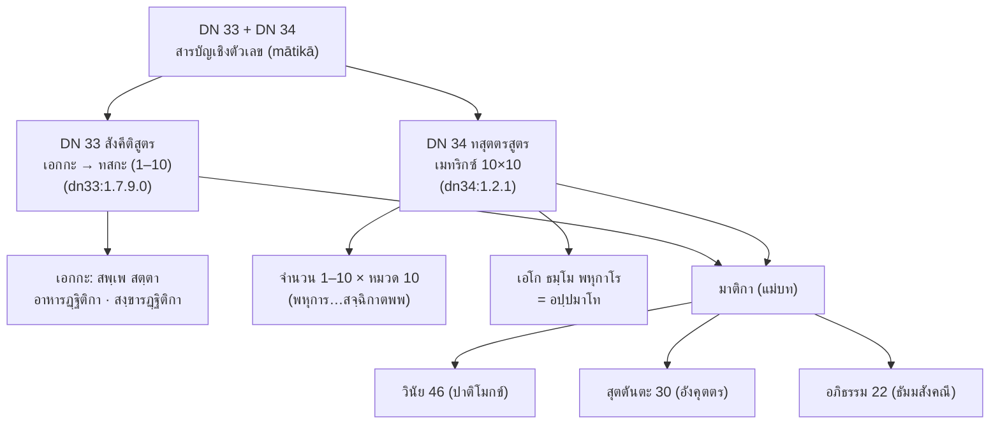

# สังคีติสูตร (DN 33) + ทสุตตรสูตร (DN 34) เป็น "สารบัญ" ของพระไตรปิฎกได้หรือไม่
### รายงานวิจัย — root ชนิด "สารบัญเชิงตัวเลข (mātikā)" วิเคราะห์จากตัวบทบาลีโรมันเท่านั้น

> **ข้อกำหนดวิธีวิจัย:** หลักฐานทุกชิ้นจากตัวบท**ภาษาบาลีโรมัน**โดยตรง (tripitaka-mcp local + online, ฐานข้อมูล SuttaCentral `bilara-data` CC0) — ไม่ได้พึ่งการแปลภาษาอังกฤษ/ภาษาอื่นในการวิเคราะห์ ตัวเลขจาก `survey_corpus` (exhaustive `complete:true`)

---

## บทคัดย่อ (Abstract)

**คำตอบ: ได้ และเป็น "สารบัญโดยธรรมชาติ" ที่ตัวพระไตรปิฎกสร้างไว้เอง — ต่างจาก SN 56.11 ที่เป็น "สารบัญเชิงเนื้อหา"**

สังคีติสูตร ([DN 33](https://tripitaka-mcp.com/read/dn33)) และทสุตตรสูตร ([DN 34](https://tripitaka-mcp.com/read/dn34)) **จัดหมวดธรรมตามจำนวน 1–10 (มัชฌิมมาติกา)** — คือ "สารบัญเชิงโครงสร้าง" ที่พระคัมภีร์ใช้จัดระเบียบธรรมะทั้งหมด ไม่ใช่การตีความของเรา:

- **DN 33 (สังคีติ):** เอกกะ(1) → ทุกะ(2) → … → ทสกะ(10) โดยมีคำปิดท้ายว่า *"สพฺเพเหว สงฺคายิตพฺพํ น วิวทิตพฺพํ"* (ทุกคนควรสังคายนาร่วมกัน ไม่วิวาท) — [dn33:1.7.6](https://tripitaka-mcp.com/read/dn33#dn33:1.7.6)
- **DN 34 (ทสุตตร):** **เมทริกซ์ 10×10** = จำนวน 1–10 × หมวด 10 (พหุการ, ภาเวตพพ, ปริญเญยย, ปหาตพพ, หานภาคิย, วิเสสภาคิย, ทุปปฏิวิชฌ, อุปปาเทตพพ, อภิญเญยย, สจฺฉิกาตพพ) โดยมีจุดประสงค์ประกาศไว้ตรง ๆ ว่า *"ธมฺมํ นิพฺพานปตฺติยา"* (ธรรมเพื่อการบรรลุนิพพาน) — [dn34:1.1.7](https://tripitaka-mcp.com/read/dn34#dn34:1.1.7), [dn34:1.2.1](https://tripitaka-mcp.com/read/dn34#dn34:1.2.1)

**ข้อค้นพบชี้ขาด:** ศัพท์ **"มาติกา" (mātikā = แม่บท/สารบัญ) ปรากฏครบทั้ง 3 ปิฎก** — วินัย 46, สุตตันตะ 30, อภิธรรม 22 (รวม 98 ข้อความ/50 พระสูตร) — สะท้อนว่าโครงสร้าง "แม่บทเชิงตัวเลข" ของ DN 33/34 เป็น **ต้นแบบของโครงสร้างทั้งพระไตรปิฎก**: วินัย (ปาติโมกข์/วิภังค์), สุตตันตะ (อังคุตตรนิกายเชิงตัวเลข), อภิธรรม (ธัมมสังคณี มาติกา)

---

## 1. บทนำและสมมติฐาน

**คำถาม:** DN 33 + DN 34 ใช้เป็น "สารบัญ" ของพระไตรปิฎกได้หรือไม่ และเป็นสารบัญชนิดใด (ต่างจาก SN 56.11 ที่เป็น "สารบัญเนื้อหา" อย่างไร)?

**สมมติฐาน H1 (ทดสอบแล้ว สนับสนุน):** DN 33/34 เป็น "สารบัญเชิงโครงสร้าง (mātikā)" ที่จัดหมวดธรรมตามจำนวน 1–10 — ต่างจาก SN 56.11 ที่เป็น "สารบัญเชิงเนื้อหา" (อริยสัจ 4 = เนื้อหาธรรมะทั้งหมด)

**สมมติฐาน H2 (ทดสอบแล้ว สนับสนุน):** ศัพท์ "มาติกา" กระจายครบ 3 ปิฎก เพราะโครงสร้าง "แม่บท" เป็นแม่แบบการจัดหมวดของทั้งวินัย/สุตตันตะ/อภิธรรม

---

## 2. วิธีการ (Methods)

1. ดึงเฉพาะส่วนสำคัญของ DN 33/DN 34 (ไม่ fetch เต็ม ตามข้อกำหนด): `get_sutta(dn33, pali, offset/limit)` — บทนำ + หมวดเอกกะ; `get_sutta(dn34, pali, offset/limit)` — บทเปิด + หมวด "เอโก ธมฺโม" + ทัสสุทานะ
2. `survey_corpus` (pali, stem, exhaustive) ศัพท์ใหม่: saṅgīti, dasuttara, bala (สาศัพท์ที่มีแล้ว: mātikā, sīla, samādhi, indriya, ฯลฯ)
3. สกัดโครงสร้างจาก outline ที่รู้แล้ว + ตัวบทที่ fetch

---

## 3. ผล (Results)

### 3.1 โครงสร้างภายใน (จากบาลีล้วน)

```
DN 33 สังคีติสูตร (1167 ข้อความ) — บริบท: นิครนถ์นาฏบุตรสิ้นชีพ, สาวกแตกแยก
   สารีบุตรจึงชวน "สงฺคายิตพฺพํ น วิวทิตพฺพํ" (สังคายนาร่วม ไม่วิวาท)  [dn33:1.7.6]
   แล้วจัดหมวด: เอกกะ(1) → ทุกะ(2) → ติกะ(3) → จตุกกะ(4) → ปัญจกะ(5)
               → ฉักกะ(6) → สัตตกะ(7) → อัฏฐกะ(8) → นวกะ(9) → ทสกะ(10)
   ตัวอย่างเอกกะ: "สพฺเพ สตฺตา อาหารฏฺฐิติกา · สงฺขารฏฺฐิติกา"  [dn33:1.8.2]

DN 34 ทสุตตรสูตร (894 ข้อความ) — สารีบุตรแสดง:
   "ทสุตฺตรํ ปวกฺขามิ, ธมฺมํ นิพฺพานปตฺติยา; ทุกฺขสฺสนฺตกิริยาย, สพฺพคนฺถปฺปโมจนํ"  [dn34:1.1.7]
   เมทริกซ์ 10×10: จำนวน 1–10 × หมวด 10  [dn34:1.2.1]
   (พหุการ · ภาเวตพพ · ปริญเญยย · ปหาตพพ · หานภาคิย · วิเสสภาคิย
    · ทุปปฏิวิชฌ · อุปปาเทตพพ · อภิญเญยย · สจฺฉิกาตพพ)
   ตัวอย่าง: "เอโก ธมฺโม พหุกาโร = อปฺปมาโท กุสเลสุ ธมฺเมสุ"  [dn34:1.2.3]
```

### 3.2 การกระจายศัพท์หลักทั่วพระไตรปิฎก

| ศัพท์ (ลายเซ็น) | สุตตันตะ | วินัย | อภิธรรม | รวม | ครอบคลุม |
|---|---:|---:|---:|---:|---|
| **saṅgīti** (สังคีติ) | 10 | 7 | 0 | 17 | ◐ (สุตตันตะ+วินัย) |
| **dasuttara** (ทสุตตร) | 5 | 0 | 0 | 5 | ◐ (เฉพาะ DN34) |
| **mātikā** (มาติกา/แม่บท) | 30 | **46** | 22 | 98 | ✅ ครบ 3 ปิฎก |
| bala (พล/กำลัง) ⚠ | 1330 | 154 | 82 | 1566 | ✅ (over-match bāla) |
| sīla (ศีล) ⚠ | 2296 | 310 | 633 | 3239 | ✅ |
| samādhi (สมาธิ) | 1847 | 83 | 374 | 2304 | ✅ |
| indriya (อินทรีย์) | 689 | 17 | **1849** | 2555 | ✅ |
| satipaṭṭhāna | 369 | 4 | 96 | 469 | ✅ |
| bojjhaṅga | 629 | 12 | 119 | 760 | ✅ |
| ariyasacca | 344 | 23 | 34 | 401 | ✅ |
| nibbāna | 1408 | 14 | 377 | 1799 | ✅ |

**ข้อมูลเต็ม:** [`survey_data.csv`](<survey_data.csv>)

### 3.3 ข้อค้นพบชี้ขาด

**1) DN 34 เป็น "เมทริกซ์ 10×10" — โครงสร้างสารบัญที่แจงไว้ชัดเจนที่สุดในพระไตรปิฎก** — [dn34:1.2.1](https://tripitaka-mcp.com/read/dn34#dn34:1.2.1) ประกาศหมวด 10 หมวด (พหุการ→สจฺฉิกาตพพ) × จำนวน 1–10 = **ดัชนี 100 ช่อง** ที่ครอบคลุมธรรมะทั้งเพื่อละ/เพื่อเจริญ/เพื่อทำให้แจ้ง

**2) DN 33 ระบุ "จุดประสงค์ของสารบัญ" ไว้ตรง ๆ** — *"สพฺเพเหว สงฺคายิตพฺพํ น วิวทิตพฺพํ … พฺรหฺมจริยํ อทฺธนิยํ อสฺส จิรฏฺฐิติกํ"* (เพื่อให้พรหมจรรย์ตั้งมั่นยั่งยืนนาน) — [dn33:1.7.6](https://tripitaka-mcp.com/read/dn33#dn33:1.7.6) — คือ "สารบัญที่ใช้เพื่อรักษาคำสอนไม่ให้แตกแยก" ต่างจาก SN 56.11 ที่เป็นสารบัญเพื่อ "สรุปเนื้อหา"

**3) "มาติกา" ครบ 3 ปิฎก (98 ข้อความ) สะท้อน "แม่บท" เป็นโครงสร้างร่วมของทั้งพระไตรปิฎก** — วินัย 46 (โครงสร้างปาติโมกข์/วิภังค์จัดเป็นมาติกา), สุตตันตะ 30 (อังคุตตรนิกายจัดตามจำนวน), อภิธรรม 22 (ธัมมสังคณีมี "มาติกา" เป็นหัวใจ) — แปลว่าโครงสร้าง "จัดหมวดตามจำนวน" ของ DN 33/34 เป็น **แม่แบบเชิงโครงสร้าง** ที่ทั้งสามปิฎกใช้ร่วมกัน

### 3.4 เทียบ "สารบัญเชิงตัวเลข" กับ "สารบัญเชิงเนื้อหา"

| | SN 56.11 (สารบัญเนื้อหา) | DN 33 + DN 34 (สารบัญเชิงตัวเลข) |
|---|---|---|
| **สิ่งที่สรุป** | เนื้อหา (อริยสัจ 4 = ธรรมะทั้งหมด) | โครงสร้าง (มาติกา 1–10 = การจัดหมวดทั้งหมด) |
| **กลไก** | 4 สัจจะครอบคลุมทุกธรรม | จำนวน 1–10 ครอบคลุมทุกหมวด |
| **จุดประสงค์** | ประกาศการตรัสรู้ + หมุนธรรมจักร | สังคายนาร่วมไม่วิวาท + เพื่อนิพพาน |
| **ความสัมพันธ์** | "ธรรมะคืออะไร" | "ธรรมะจัดหมวดอย่างไร" |

---

## 4. แผนที่และโครงสร้าง (The Map)


- **SVG (ความละเอียดสูง):** [`map.svg`](<map.svg>)
- **โครงสร้าง node–edge (11 ขอบ, 12 โหนด):** [`map_edges.csv`](<map_edges.csv>) / [`map_graph.json`](<map_graph.json>)



---

## 5. อภิปราย (Discussion)

### 5.1 root สองชนิด: "เนื้อหา" vs "โครงสร้าง"

งาน 5 สูตรก่อนหน้าพบ root ชนิด **"เนื้อหา"** (SN 56.11 = อริยสัจ 4, DN 2 = ไตรสิกขา ฯลฯ) — คือพระสูตรที่**เนื้อหา**ครอบคลุมธรรมะทั้งหมด. แต่ DN 33/34 เป็น root ชนิด **"โครงสร้าง"** — คือพระสูตรที่**วิธีการจัดหมวด** (จำนวน 1–10) ครอบคลุมธรรมะทั้งหมด. นี่คือการค้นพบสำคัญ: **พระไตรปิฎกมี "สารบัญ" ถึง 2 ชั้น** — ชั้นเนื้อหา (อริยสัจ) + ชั้นโครงสร้าง (มาติกา)

### 5.2 ทำไม "มาติกา" จึงครบ 3 ปิฎก

คำว่า "มาติกา" (แม่บท) หมายถึง "บัญชีรายการหัวข้อ" ที่ใช้เป็นโครง 3 ปิฎกใช้ร่วมกัน:
- **วินัย:** ปาติโมกข์และวิภังค์จัดหัวข้ออาบัติเป็น "มาติกา" (46 ข้อความ — มากที่สุด)
- **สุตตันตะ:** อังคุตตรนิกายจัดตามจำนวน 1–11 (โครงสร้างเดียวกับ DN 33/34)
- **อภิธรรม:** ธัมมสังคณีขึ้นต้นด้วย "มาติกา" (22 หัวข้อ 3 ประเภท) เป็นแกน

→ DN 33/34 จึงเป็น **ต้นกำเนิดของ "วิธีคิดเชิงมาติกา"** ที่ทั้ง 3 ปิฎกสืบทอด

### 5.3 คำตอบสุดท้าย

| ต้องการสารบัญแบบ | เลือก |
|---|---|
| สรุป**เนื้อหา**ธรรมะทั้งหมด | SN 56.11 (อริยสัจ 4) |
| เห็น**โครงสร้าง/การจัดหมวด**ทั้งหมด | **DN 33 + DN 34 (มาติกา 1–10)** |
| เกณฑ์วินิจฉัยความเป็นพุทธวจนะ | DN 16 (จตุมหาปเทส) |

**DN 33/34 เป็น "สารบัญเชิงตัวเลข" ที่ตัวคัมภีร์สร้างไว้เอง** — เหมาะใช้เป็น "ดัชนี" (index) กำกับแผนที่พระไตรปิฎก: ทุกหมวดธรรมสามารถระบุตำแหน่ง "ตามจำนวน" (1–10) ได้ เช่นเดียวกับที่อภิธรรมใช้อภิธรรมมาติกา

---

## 6. ข้อจำกัดและการตรวจสอบตนเอง

1. **ศัพท์กว้างนับเกิน:** `bala` ติด `bāla` (คนโง่), `bala` (กองทัพ/กำลัง) → 1566 เป็นขอบเขตบน ไม่สะท้อนเฉพาะ "พล 5" ที่เป็นมาติกา; `sīla` ติด `silā` (หิน)
2. **ไม่ได้ fetch ตัวบทเต็ม** ของ DN 33 (1167) / DN 34 (894) ตามข้อกำหนด — วิเคราะห์จาก outline + ส่วนสำคัญ (บทนำ, หมวดเอกกะ, ทัสสุทานะ) จึงไม่ได้แจกแจง "รายการหัวข้อ" ครบทุกหมวด (ทุกะ/ติกะ…ทสกะ)
3. **"มาติกา" เป็นหลักฐานเชิงศัพท์** ที่ยืนยัน "มีคำเรียกแม่บท" แต่การที่ DN 33/34 *เป็น* ต้นแบบของอภิธรรมมาติกาโดยตรง เป็นข้ออนุมานที่ควรตรวจกับอภิธรรมธัมมสังคณีอีกชั้น (งานต่อยอด)

---

## 7. สรุป

**สังคีติสูตร + ทสุตตรสูตร ใช้เป็น "สารบัญ" ของพระไตรปิฎกได้** โดยเป็น root ชนิด **"สารบัญเชิงตัวเลข (mātikā)"** ที่ (1) จัดหมวดธรรมตามจำนวน 1–10, (2) DN 34 เป็น "เมทริกซ์ 10×10" ที่แจงหมวด 10 หมวด × จำนวน 10 ระดับ = ดัชนี 100 ช่อง, (3) ศัพท์ "มาติกา" ครบ 3 ปิฎก (98 ข้อความ) ยืนยันว่า "วิธีจัดหมวดตามจำนวน" เป็นแม่บทโครงสร้างร่วมของทั้งวินัย/สุตตันตะ/อภิธรรม — **ต่างจาก SN 56.11 ที่เป็น "สารบัญเชิงเนื้อหา"** ทั้งสองเสริมกันเป็นแผนที่ 2 ชั้น

**ไฟล์ที่ส่งมอบ (โฟลเดอร์ `tipitaka-map/sangiti-dasuttara-mapping/`):**
- [`report.md`](<report.md>) — รายงานฉบับนี้
- [`map.svg`](<map.svg>) / [`map.png`](<map.png>) — แผนภาพโครงสร้าง
- [`survey_data.csv`](<survey_data.csv>) — ผลสำรวจ 11 ศัพท์แยกต่อปิฎก
- [`map_edges.csv`](<map_edges.csv>) / [`map_graph.json`](<map_graph.json>) — โครงสร้าง node–edge

---

*งานวิจัยนี้ใช้ข้อมูลเพื่อการศึกษา (Dhamma Dāna) เท่านั้น; โปรดสอบทานกับฉบับพิมพ์ล่าสุดก่อนอ้างอิงทางวิชาการ*
